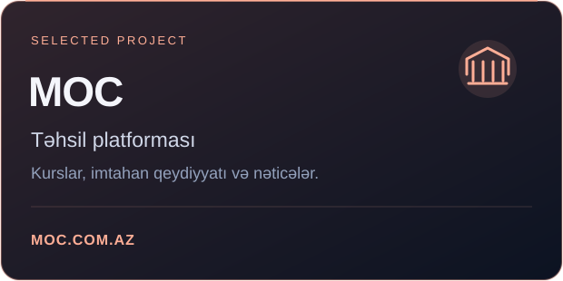
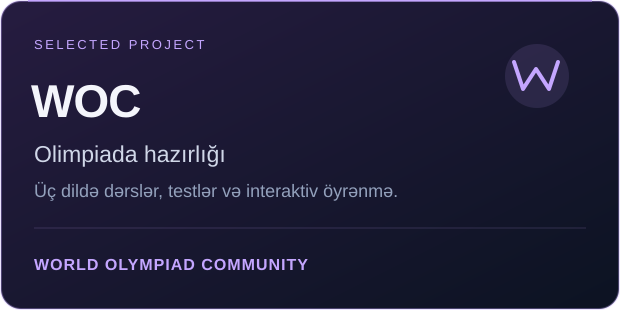
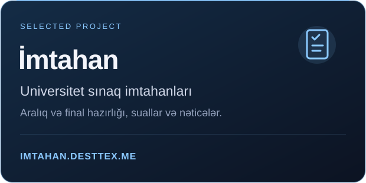
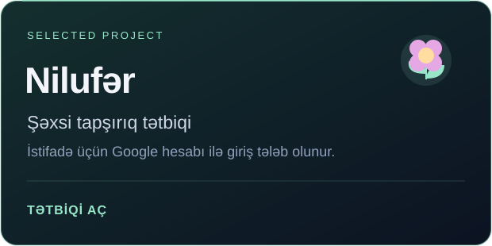
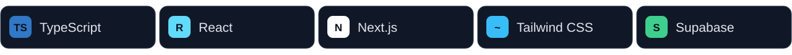

  

<h2 align="center">Salam, mən Desttex 👋</h2>

  Təhsil, olimpiada hazırlığı və gündəlik məhsuldarlıq üçün veb layihələri. 
  Welcome to my corner of GitHub.

  <a href="https://moc.com.az/"><strong>MOC</strong></a> &nbsp; · &nbsp;
  <a href="https://woc-fawn-kappa.vercel.app/"><strong>WOC</strong></a> &nbsp; · &nbsp;
  <a href="https://imtahan.desttex.me/"><strong>İmtahan</strong></a> &nbsp; · &nbsp;
  <a href="https://to-do-ebon-sigma.vercel.app/"><strong>Nilufər</strong></a>

### ✨ Seçilmiş layihələr

  
  

  
  

Nilufər tətbiqindən istifadə üçün Google hesabı ilə giriş tələb olunur.

### 🧩 Layihələrdə istifadə etdiyim texnologiyalar

   
  IDEAS &nbsp; → &nbsp; INTERFACES &nbsp; → &nbsp; EXPERIENCES

