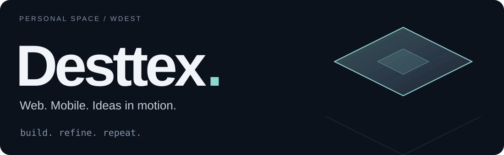
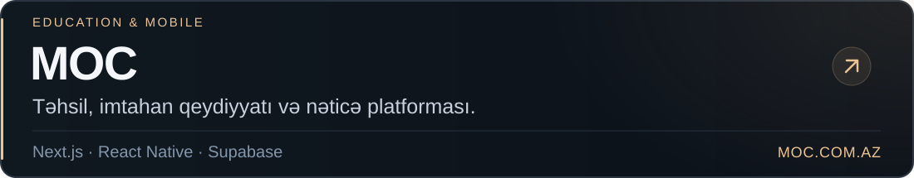
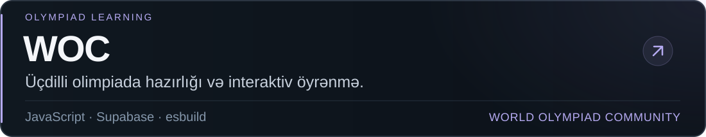
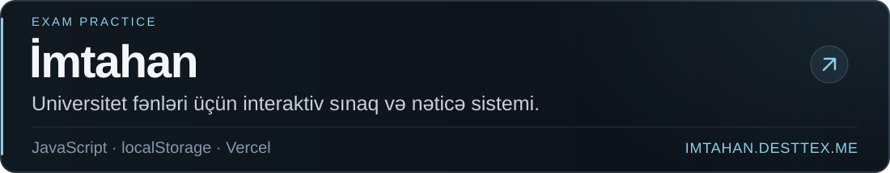
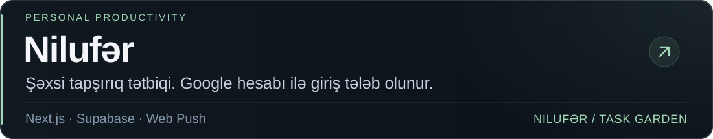

<picture>
  <source media="(prefers-reduced-motion: reduce) and (max-width: 600px)" srcset="./assets/hero-premium-still-mobile.svg" />
  <source media="(prefers-reduced-motion: reduce)" srcset="./assets/hero-premium-still-desktop.svg" />
  <source media="(max-width: 600px)" srcset="./assets/hero-premium-mobile.svg" />
  
</picture>

  Veb və mobil tətbiqlər, təhsil platformaları, interaktiv təcrübələr.

  <a href="https://moc.com.az/">MOC</a> &nbsp; / &nbsp;
  <a href="https://woc-fawn-kappa.vercel.app/">WOC</a> &nbsp; / &nbsp;
  <a href="https://imtahan.desttex.me/">İmtahan</a> &nbsp; / &nbsp;
  <a href="https://to-do-ebon-sigma.vercel.app/">Nilufər</a>

## Seçilmiş layihələr

<a href="https://moc.com.az/">
  <picture>
    <source media="(max-width: 600px)" srcset="./assets/moc-mobile.svg" />
    
  </picture>
</a>

<a href="https://woc-fawn-kappa.vercel.app/">
  <picture>
    <source media="(max-width: 600px)" srcset="./assets/woc-mobile.svg" />
    
  </picture>
</a>

<a href="https://imtahan.desttex.me/">
  <picture>
    <source media="(max-width: 600px)" srcset="./assets/imtahan-mobile.svg" />
    
  </picture>
</a>

<a href="https://to-do-ebon-sigma.vercel.app/">
  <picture>
    <source media="(max-width: 600px)" srcset="./assets/nilufer-mobile.svg" />
    
  </picture>
</a>

## Texnologiyalar

Layihələrimdə istifadə etdiyim dillər, platformalar və alətlər.

**Dillər**  
TypeScript · JavaScript · HTML · CSS · SQL  
Python: məlumat idxalı və sənəd emalı alətləri.

**Veb və mobil tətbiqlər**  
React · Next.js · React Native · Expo · React Navigation · i18next

**Backend və məlumat**  
Node.js · Supabase · PostgreSQL · Supabase Auth · IndexedDB · localStorage · Web Push

**İnterfeys, animasiya və 3D**  
Tailwind CSS · Framer Motion · Lenis · Three.js · React Three Fiber · Drei · Recharts

**Süni intellekt və sənədlər**  
Gemini API · OpenAI API · React PDF · PDF-lib · XLSX

**Yayım və alətlər**  
Git / GitHub · Vercel · Docker · Nginx · GitHub Actions · esbuild

**Keyfiyyət və testlər**  
Playwright · Node.js test runner · PGlite · ESLint

 

DESTTEX &nbsp; / &nbsp; WDEST

